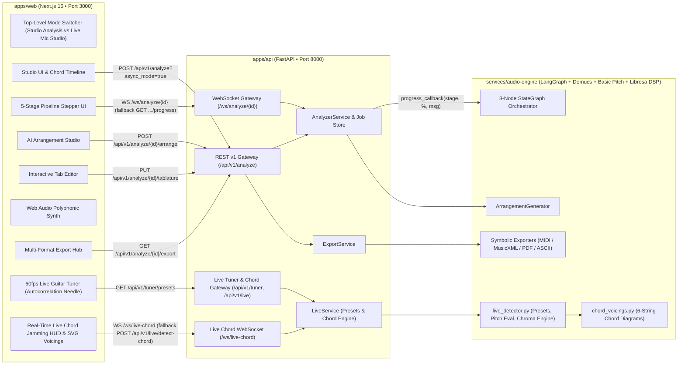
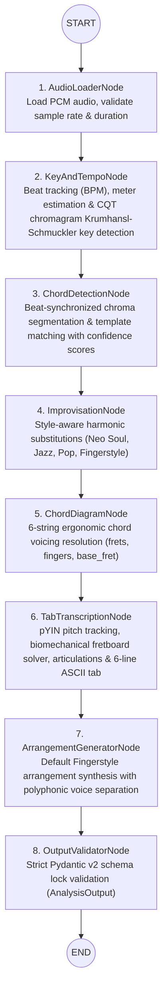

# Arpegia — AI-Powered Guitar Intelligence Platform

> **Audio Analysis • Real-Time Async Pipeline Progress Streaming (WebSocket + HTTP Polling) • Chord & Key Intelligence • Biomechanical Guitar Tablature • Interactive Fretboard & Web Audio Synth • AI Fingerstyle & Style Arrangement Studio • Multi-Format Score Export (MIDI, MusicXML, PDF, ASCII) • Live Microphone Guitar Tuner (60fps Autocorrelation) • Real-Time Mic Chord Jamming Studio**

---

## Overview

**Arpegia** is an end-to-end AI music intelligence platform engineered for guitarists, producers, and educators. It provides dual top-level operating modes:
1. **🎵 Studio Analysis:** Ingests raw audio tracks (`.mp3` or `.wav`), streams live pipeline telemetry across 5 execution stages (**Separating Stems** -> **Detecting Key & Tempo** -> **Recognizing Chords** -> **Transcribing Guitar Tab** -> **Generating Fingerstyle Arrangement**) via dual-transport **WebSocket** and **HTTP Polling**, executes digital signal processing (DSP) and LangGraph multi-agent orchestration to extract musical key, tempo, chord progressions, and fundamental pitches, maps notes onto a biomechanically playable 6-string guitar fretboard via Viterbi trellis dynamic programming, synthesizes polyphonic style arrangements (**Fingerstyle**, **Neo Soul**, **Jazz Chord Melody**, **Acoustic Strumming**), and exports publication-ready scores across **MIDI**, **MusicXML 4.0**, **PDF**, and **ASCII Tab**.
2. **🎙️ Live Mic Studio:** High-precision real-time live performance suite featuring a **60fps Web Audio Microphone Guitar Tuner** (with smooth needle gauge, microtonal cents deviation, target frequency locking, reference tone plucking, and 5 canonical tuning presets) and a **Real-Time Mic Chord Jamming Studio** (sub-50ms 12-bin chromagram streaming over WebSocket `WS /ws/live-chord`, HTTP fallback `POST /api/v1/live/detect-chord`, dynamic 6-string SVG `ChordDiagram` voicings, rolling chord progression history, and built-in interactive Mic Simulator).

---

## Architecture & LangGraph Multi-Agent Audio Pipeline

### System Architecture



### LangGraph 8-Node Audio Intelligence Pipeline (`services/audio-engine`)



### Monorepo Directory Structure

```text
arpegia/
├── apps/
│   ├── web/                  # Next.js 16 App Router, TypeScript, Tailwind CSS, Web Audio Synth
│   └── api/                  # Python FastAPI Backend Gateway (REST v1, CORS, ErrorEnvelope)
├── services/
│   └── audio-engine/         # Python Audio DSP (Librosa, SoundFile) & LangGraph Orchestrator
├── packages/
│   └── shared-types/         # Locked TypeScript interfaces & Pydantic v2 physical contracts
├── infrastructure/
│   └── docker/               # Production Dockerfiles (Dockerfile.api, Dockerfile.web, Dockerfile.audio-engine)
├── scripts/
│   └── e2e_test.mjs          # Automated cross-platform Phase 1 + 2 + 3 E2E smoke test
├── docs/
│   ├── api-contract.md       # Locked REST API & schema contract specification
│   └── architecture.md       # Monorepo architecture & service boundary guide
├── docker-compose.yml        # Multi-container orchestration with healthchecks
├── pytest.ini                # Unified pytest configuration across api and audio-engine
├── .env.example              # Environment variable template (Phases 1–3)
└── README.md
```

---

## Complete Feature Breakdown (Phases 1, 2, 3, 4 & 5)

### Phase 1: Chord, Key & Harmonic Intelligence
- **DSP Key & Tempo Extraction:** Beat grid tracking, BPM detection, time signature estimation, and CQT chromagram key signature analysis.
- **Synchronized Chord Timeline:** Timestamped chord detection with confidence metrics and interactive seek/loop playback controls.
- **Harmonic Improvisation & Reharmonization Engine:** Suggests genre-specific chord substitutions (e.g., `Gmaj7`, `G6/9`, `Em9`, `Cmaj9#11`, `D13sus4`) tailored to the detected key.

### Phase 2: Guitar Tablature Transcription, SVG Chord Diagrams & Interactive Synth
- **Biomechanical Guitar Tablature Transcription:** Maps detected pitches onto strings `1–6` and frets `0–24` while minimizing hand shifts, detecting articulations (`normal`, `hammer-on`, `pull-off`, `slide`, `bend`), and rendering a canonical 6-line `ascii_tab`.
- **6-String SVG Chord Voicing Diagrams & 12-Fret Neck Visualizer:** Renders fret positions (`-1` muted, `0` open, `1..24` fretted), finger numbers (`1..4`), and base fret indicators with instant Web Audio chord strum auditioning.
- **Interactive Tab Editor (`PUT /api/v1/analyze/{job_id}/tablature`):** Click any note on the 6-string timeline to edit string, fret, or articulation technique; automatically recomputes MIDI pitch, scientific pitch notation, and canonical 6-line ASCII tab.
- **Zero-Dependency Web Audio Plucked-String Synthesizer:** Realistic Karplus-Strong / harmonic-decay acoustic guitar synthesis with tempo scaling (`0.5x` – `1.5x`), loop regions, and live playhead synchronization.

### Phase 3: AI Fingerstyle & Style Arrangement Studio + Multi-Format Score Export
- **AI Arrangement Studio (`POST /api/v1/analyze/{job_id}/arrange`):** Generates playable guitar arrangements across 4 musical styles and 3 difficulty tiers (`Beginner`, `Intermediate`, `Advanced`) with capo transposition (`0..12`) and tempo scaling (`0.5..1.5`):
  - **Fingerstyle:** Alternating root/fifth thumb bass on strings 4–6, arpeggiated inner chord tones on strings 2–4, and plucked melody on strings 1–2.
  - **Neo Soul:** Extended `maj9`/`m11`/`6/9` voicings, syncopated thumb slaps/ghost notes (`percussive`), and double-stop melody slides.
  - **Jazz Chord Melody:** Walking basslines on beats 1 & 3 paired with Drop-2 and shell guide-tone voicings beneath the lead melody.
  - **Acoustic Strumming:** Meter-aligned boom-chuck bass picks, full chord strums, and rhythmic muted backbeat accents.
- **Polyphonic Voice Separation & Per-Voice Synth Mixer:** Every `TabNote` is tagged with a polyphonic `voice` role (`"melody"`, `"bass"`, `"harmony"`, `"percussive"`), color-coded in the UI with independent **Mute / Solo** voice toggles in the Web Audio synthesizer.
- **Multi-Format Symbolic Export Hub (`GET /api/v1/analyze/{job_id}/export`):** Deterministic, zero-external-binary exporters for both base transcriptions and custom arrangements:
  - **Standard MIDI (`.mid`):** Format 0 binary SMF (`MThd` + `MTrk`) with tempo meta events, acoustic guitar program changes, and voice-weighted velocities.
  - **MusicXML 4.0 (`.musicxml`):** Compatible with GuitarPro, MuseScore, and Dorico, featuring 6-line `<staff-details>`, `<staff-tuning>`, `<capo>`, `<technical><string>/<fret>`, and articulation tags.
  - **Printable PDF Score (`.pdf`):** Pure-Python `%PDF-1.4` score generator with song metadata, chord progression, and monospace Courier tablature systems.
  - **Formatted ASCII Tab Sheet (`.txt`):** Clean text sheet with metadata header, chord sequence, and 6-line guitar staff.

### Phase 4: Real-Time Async Pipeline Streaming & Telemetry (WebSocket + HTTP Polling Fallback)
- **Dual-Transport Streaming Client (`apps/web`):**
  - **WebSocket Primary Transport (`WS /ws/analyze/{job_id}`):** Subscribes to real-time `JobProgressEvent` frames streamed at millisecond latency as each LangGraph node finishes.
  - **HTTP Polling Automatic Fallback (`GET /api/v1/analyze/{job_id}/progress`):** Transparently engages if WebSocket encounters connection drops or firewall restrictions, polling at configurable intervals (`ARPEGIA_ASYNC_POLL_INTERVAL_MS=800`).
  - **Thread-to-Async Event Loop Bridging:** Background DSP execution (`asyncio.to_thread`) uses thread-safe scheduling (`loop.call_soon_threadsafe(queue.put_nowait, event)`) to publish live telemetry without blocking FastAPI's async event loop.
- **5-Stage Interactive Pipeline Stepper UI:**
  1. `separating_stems` (**0% -> 25%**): Demucs 4-stem neural source separation isolating guitar, bass, drums, and vocal stems.
  2. `detecting_key_tempo` (**25% -> 40%**): Beat grid tracking (BPM) and Krumhansl-Schmuckler chromagram key signature detection.
  3. `detecting_chords` (**40% -> 60%**): Harmonic chroma segmentation, chord template matching, voicings, and genre-specific improvisations.
  4. `transcribing_tablature` (**60% -> 85%**): Polyphonic note tracking via Basic Pitch neural network paired with Viterbi dynamic programming trellis decoding for biomechanical fretboard optimization.
  5. `generating_arrangement` (**85% -> 100%**): Polyphonic Fingerstyle voice separation (thumb bass + arpeggio harmony + melody) and Pydantic v2 schema lock validation.
- **Seamless Studio View Handoff:** Once the pipeline reaches `100%` and emits `job.completed`, the stepper smoothly transitions directly to the interactive Studio workbench with the full `AnalysisResponse`.

### Phase 5: Live Microphone Guitar Tuner (60fps Web Audio Autocorrelation + 5 Tuning Presets) & Real-Time Mic Chord Jamming Studio
- **High-Precision 60fps Microphone Guitar Tuner (`GuitarTuner`):**
  - **Autocorrelation / YIN Pitch Tracking:** Real-time Web Audio API pitch engine running at 60fps via `requestAnimationFrame` with parabolic interpolation, computing fundamental frequency ($f_0$) and microtonal deviation in cents ($1200 \times \log_2(f / f_{\text{target}})$) clamped to $[-50.0, +50.0]$.
  - **Dynamic Needle Gauge & Tuning Badges:** Responsive visual needle gauge, target frequency indicator, and tuning status badge (`in_tune` when $|cents| \le 3.5$, `flat` when $cents < -3.5$, or `sharp` when $cents > +3.5$).
  - **6-String Visual String Selector:** Displays guitar strings 1–6 with auto-detect string mode (minimizing cents deviation) or manual string override locking.
  - **5 Canonical Guitar Tuning Presets (`GET /api/v1/tuner/presets`):**
    - `standard`: E2 (82.41 Hz), A2 (110.00 Hz), D3 (146.83 Hz), G3 (196.00 Hz), B3 (246.94 Hz), E4 (329.63 Hz)
    - `drop_d`: D2 (73.42 Hz), A2 (110.00 Hz), D3 (146.83 Hz), G3 (196.00 Hz), B3 (246.94 Hz), E4 (329.63 Hz)
    - `half_step_down`: Eb2 (77.78 Hz), Ab2 (103.83 Hz), Db3 (138.59 Hz), Gb3 (185.00 Hz), Bb3 (233.08 Hz), Eb4 (311.13 Hz)
    - `open_g`: D2 (73.42 Hz), G2 (98.00 Hz), D3 (146.83 Hz), G3 (196.00 Hz), B3 (246.94 Hz), D4 (293.66 Hz)
    - `dadgad`: D2 (73.42 Hz), A2 (110.00 Hz), D3 (146.83 Hz), G3 (196.00 Hz), A3 (220.00 Hz), D4 (293.66 Hz)
    Supports custom concert pitch reference scaling (`reference_a4_hz`, e.g., 432 Hz).
  - **Interactive Reference Tone Plucking:** Instant Karplus-Strong Web Audio plucked string sound for each target string note to facilitate ear-tuning.
- **Real-Time Mic Chord Jamming Studio (`LiveChordDetector`):**
  - **Sub-50ms 12-Bin Chromagram Detection:** Extracts live harmonic energy vectors $[C, C\sharp, D, D\sharp, E, F, F\sharp, G, G\sharp, A, A\sharp, B]$ and matches against 108 precomputed chord templates (12 roots $\times$ 9 qualities: Major, Minor, 7, maj7, m7, sus4, sus2, dim, aug).
  - **Bi-Directional WebSocket Streaming (`WS /ws/live-chord`):** Continuous frame streaming accepting `LiveChordFrameRequest` JSON frames (or `{ "type": "ping" }` heartbeat) and returning structured `LiveChordDetectionResult` with sub-50ms latency.
  - **Automatic Fallback Architecture:** Seamlessly falls back to `POST /api/v1/live/detect-chord` REST endpoint and client-side cosine similarity DSP if the network is interrupted or when operating offline in Mock Mode.
  - **Distraction-Free Live HUD:** High-contrast full-screen performance interface displaying the recognized chord symbol, quality label, confidence meter, detected pitch classes, and real-time 6-string SVG `ChordDiagram` voicing with frets and fingerings.
  - **Rolling Chord Progression History:** Automatically captures and timestamps recognized chord changes into a scrollable progression tape for jam session review.
  - **Built-in Microphone Demo Simulator (`LiveMicSimulator`):** Allows instant evaluation of tuner needle tracking and live chord recognition without requiring hardware microphone permissions.
- **Top-Level Mode Switcher:** Seamless navbar switcher toggling between `🎵 Studio Analysis` (audio upload, stem separation, transcription, arrangement, export) and `🎙️ Live Mic Studio` (guitar tuner, real-time chord detection) while preserving application state.

---

## Canonical Port Registry & REST API Summary

| Service | Workspace Path | Port | Base URL / Protocols |
| :--- | :--- | :--- | :--- |
| **Web Frontend (Next.js)** | `apps/web/` | `3000` | `http://localhost:3000` |
| **Backend API Gateway (FastAPI)** | `apps/api/` | `8000` | `http://localhost:8000`<br>`ws://localhost:8000/ws/analyze/{job_id}`<br>`ws://localhost:8000/ws/live-chord` |
| **Audio Engine (DSP & LangGraph)** | `services/audio-engine/` | In-process / Worker | Invoked by `apps/api` |

| Method | Endpoint | Description |
| :--- | :--- | :--- |
| `GET` | `/health` | Service health check (`200 OK`) |
| `POST` | `/api/v1/analyze` | Upload `.mp3`/`.wav`. Default `async_mode=false` (sync); `async_mode=true` (async background job) |
| `GET` | `/api/v1/analyze/{job_id}/progress` | Poll real-time 5-stage pipeline progress and steps |
| `WS` | `/ws/analyze/{job_id}` | Stream real-time `JobProgressEvent` frames until `job.completed` |
| `GET` | `/api/v1/analyze/{job_id}` | Retrieve stored analysis job, tablature, and arrangements |
| `PUT` | `/api/v1/analyze/{job_id}/tablature` | Update note string/fret/technique and regenerate `ascii_tab` |
| `POST` | `/api/v1/analyze/{job_id}/arrange` | Synthesize and persist a new `ArrangementVariation` |
| `GET` | `/api/v1/analyze/{job_id}/export` | Download score as `midi`, `musicxml`, `pdf`, or `ascii` |
| `GET` | `/api/v1/tuner/presets` | Retrieve 5 canonical guitar tuning presets (standard, drop_d, half_step_down, open_g, dadgad) with exact physical target frequencies |
| `POST` | `/api/v1/live/detect-chord` | Real-time single-frame chord recognition from 12-bin chroma vector or PCM audio with 6-string `ChordDiagram` voicing |
| `WS` | `/ws/live-chord` | Low-latency real-time bidirectional WebSocket stream for live microphone chord jamming with `{ "type": "ping" }` heartbeat support |

Full request/response schemas and error envelopes are documented in [docs/api-contract.md](docs/api-contract.md).

---

## Quickstart & Development Guide

### 1. 1-Command Docker Quickstart (Recommended)

```bash
cp .env.example .env
docker compose up --build
```

- **Web Studio UI:** [http://localhost:3000](http://localhost:3000) (`NEXT_PUBLIC_USE_MOCK=false` by default for live backend operation; includes an interactive UI toggle for Mock Mode fallback)
- **FastAPI Swagger UI:** [http://localhost:8000/docs](http://localhost:8000/docs)
- **API Healthcheck:** [http://localhost:8000/health](http://localhost:8000/health)

### 2. Local Development Startup

#### Terminal 1 — Backend API + Audio Engine (`Port 8000`)

**macOS / Linux:**
```bash
python3 -m venv .venv
source .venv/bin/activate
pip install -r apps/api/requirements.txt -r services/audio-engine/requirements.txt
PYTHONPATH="apps/api:services/audio-engine" uvicorn app.main:app --app-dir apps/api --reload --port 8000
```

**Windows (PowerShell):**
```powershell
python -m venv .venv
.\.venv\Scripts\Activate.ps1
pip install -r apps/api/requirements.txt -r services/audio-engine/requirements.txt
$env:PYTHONPATH="apps/api;services/audio-engine"
uvicorn app.main:app --app-dir apps/api --reload --port 8000
```

#### Terminal 2 — Next.js Web Studio (`Port 3000`)

```bash
cd apps/web
npm install
npm run dev
```

---

## Automated Testing & Verification

### 1. Full Pytest Suite (`services/audio-engine/tests` & `apps/api/tests`)
Runs unit, contract, and end-to-end tests across the DSP pipeline, ML stem separation & Basic Pitch polyphonic transcription, Viterbi fretboard solver, arrangement generator, symbolic exporters, and FastAPI REST/WebSocket endpoints:

```bash
pytest
```

### 2. Automated Cross-Platform Full-Stack E2E Smoke Test (`scripts/e2e_test.mjs`)
Verifies the complete Phase 1 + 2 + 3 + 4 + 5 flow against a live server (automatically spawns `uvicorn` if not already running):
1. `GET /health` -> asserts `200 OK`.
2. `POST /api/v1/analyze` (Synchronous Backward-Compatibility Check) with a synthesized multi-note guitar WAV file -> validates `chords`, `improvisations`, `chord_diagrams`, `tablature`, initial `arrangements` with polyphonic `voice` roles, and completed `progress.overall_percent == 100`.
3. `PUT /api/v1/analyze/{job_id}/tablature` -> edits a note's `fret` and `technique` (`slide`) and verifies regenerated `ascii_tab`.
4. `POST /api/v1/analyze/{job_id}/arrange` (`Neo Soul`, `Advanced`, `capo: 2`, `tempo_scale: 0.9`) -> verifies new `arrangement_id` generation and persistence in `GET /api/v1/analyze/{job_id}`.
5. `GET /api/v1/analyze/{job_id}` -> asserts persistence of edits and arrangements in the job store.
6. `GET /api/v1/analyze/{job_id}/export` across all 4 formats (`midi`, `musicxml`, `pdf`, `ascii`) for both base tablature and the custom `arrangement_id` -> validates magic bytes (`MThd`, `<?xml` + `<score-partwise`, `%PDF-`, and 6-line ASCII staff).
7. `POST /api/v1/analyze?async_mode=true` & `GET /api/v1/analyze/{job_id}/progress` (Async + HTTP Polling Flow) -> polls until completion and asserts all 5 pipeline stages reached `completed`/`skipped` with full `AnalysisResponse` result.
8. `WS /ws/analyze/{job_id}` (WebSocket Real-Time Progress Streaming) -> connects to WebSocket endpoint, verifies non-decreasing `JobProgressEvent` frames `[10% -> 25% -> 30% -> ... -> 99% -> 100%]`, and asserts terminal `job.completed` frame delivers full `AnalysisResponse`.
9. `GET /api/v1/tuner/presets` (Phase 5 Guitar Tuner Presets) -> verifies all 5 presets (`standard`, `drop_d`, `half_step_down`, `open_g`, `dadgad`) and physical string frequencies (e.g. Standard String 6 E2 82.41 Hz, String 1 E4 329.63 Hz).
10. `POST /api/v1/live/detect-chord` (Phase 5 Live Chroma Detection) -> evaluates C Major 7 chroma vector (`C, E, G, B`), verifying recognition of `"Cmaj7"` (or `"C"`) with confidence > 0.5 and valid 6-string `ChordDiagram` voicing.
11. `POST /api/v1/live/detect-chord` (Phase 5 Live PCM Detection) -> evaluates synthesized A Minor chord audio (`A2 + E3 + A3 + C4 + E4`), verifying `"Am"` chord recognition and 6-string voicing diagram.
12. `WS /ws/live-chord` (Phase 5 Real-Time WebSocket Chord Jamming) -> verifies heartbeat `{ "type": "ping" }` -> `{ "type": "pong" }`, streams real-time chroma frames for progression `G -> Em -> C -> D`, and asserts instant structured `LiveChordDetectionResult` responses with full SVG voicing diagrams.

```bash
node scripts/e2e_test.mjs
```

### 3. Next.js Production TypeScript Build

```bash
cd apps/web && npm run build
```
