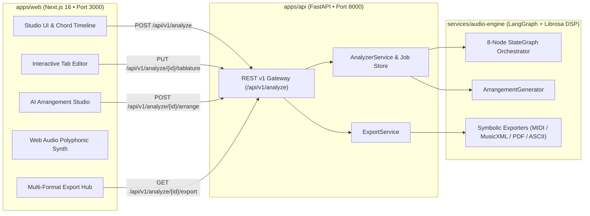
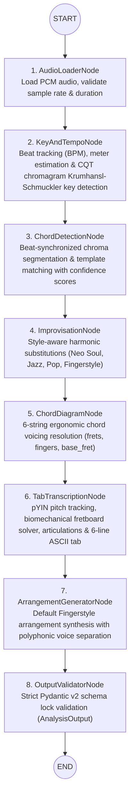

# Arpegia — AI-Powered Guitar Intelligence Platform

> **Audio Analysis • Chord & Key Intelligence • Biomechanical Guitar Tablature • Interactive Fretboard & Web Audio Synth • AI Fingerstyle & Style Arrangement Studio • Multi-Format Score Export (MIDI, MusicXML, PDF, ASCII)**

---

## Overview

**Arpegia** is an end-to-end AI music intelligence platform engineered for guitarists, producers, and educators. It ingests raw audio tracks (`.mp3` or `.wav`), executes digital signal processing (DSP) and LangGraph multi-agent orchestration to extract musical key, tempo, chord progressions, and fundamental pitches, maps notes onto a biomechanically playable 6-string guitar fretboard, synthesizes polyphonic style arrangements (**Fingerstyle**, **Neo Soul**, **Jazz Chord Melody**, **Acoustic Strumming**), and exports publication-ready scores across **MIDI**, **MusicXML 4.0**, **PDF**, and **ASCII Tab**.

---

## Architecture & LangGraph Multi-Agent Audio Pipeline

### System Architecture



### LangGraph 8-Node Audio Intelligence Pipeline (`services/audio-engine`)



### Monorepo Directory Structure

```text
arpegia/
├── apps/
│   ├── web/                  # Next.js 16 App Router, TypeScript, Tailwind CSS, Web Audio Synth
│   └── api/                  # Python FastAPI Backend Gateway (REST v1, CORS, ErrorEnvelope)
├── services/
│   └── audio-engine/         # Python Audio DSP (Librosa, SoundFile) & LangGraph Orchestrator
├── packages/
│   └── shared-types/         # Locked TypeScript interfaces & Pydantic v2 physical contracts
├── infrastructure/
│   └── docker/               # Production Dockerfiles (Dockerfile.api, Dockerfile.web, Dockerfile.audio-engine)
├── scripts/
│   └── e2e_test.mjs          # Automated cross-platform Phase 1 + 2 + 3 E2E smoke test
├── docs/
│   ├── api-contract.md       # Locked REST API & schema contract specification
│   └── architecture.md       # Monorepo architecture & service boundary guide
├── docker-compose.yml        # Multi-container orchestration with healthchecks
├── pytest.ini                # Unified pytest configuration across api and audio-engine
├── .env.example              # Environment variable template (Phases 1–3)
└── README.md
```

---

## Complete Feature Breakdown (Phases 1, 2 & 3)

### Phase 1: Chord, Key & Harmonic Intelligence
- **DSP Key & Tempo Extraction:** Beat grid tracking, BPM detection, time signature estimation, and CQT chromagram key signature analysis.
- **Synchronized Chord Timeline:** Timestamped chord detection with confidence metrics and interactive seek/loop playback controls.
- **Harmonic Improvisation & Reharmonization Engine:** Suggests genre-specific chord substitutions (e.g., `Gmaj7`, `G6/9`, `Em9`, `Cmaj9#11`, `D13sus4`) tailored to the detected key.

### Phase 2: Guitar Tablature Transcription, SVG Chord Diagrams & Interactive Synth
- **Biomechanical Guitar Tablature Transcription:** Maps detected pitches onto strings `1–6` and frets `0–24` while minimizing hand shifts, detecting articulations (`normal`, `hammer-on`, `pull-off`, `slide`, `bend`), and rendering a canonical 6-line `ascii_tab`.
- **6-String SVG Chord Voicing Diagrams & 12-Fret Neck Visualizer:** Renders fret positions (`-1` muted, `0` open, `1..24` fretted), finger numbers (`1..4`), and base fret indicators with instant Web Audio chord strum auditioning.
- **Interactive Tab Editor (`PUT /api/v1/analyze/{job_id}/tablature`):** Click any note on the 6-string timeline to edit string, fret, or articulation technique; automatically recomputes MIDI pitch, scientific pitch notation, and canonical 6-line ASCII tab.
- **Zero-Dependency Web Audio Plucked-String Synthesizer:** Realistic Karplus-Strong / harmonic-decay acoustic guitar synthesis with tempo scaling (`0.5x` – `1.5x`), loop regions, and live playhead synchronization.

### Phase 3: AI Fingerstyle & Style Arrangement Studio + Multi-Format Score Export
- **AI Arrangement Studio (`POST /api/v1/analyze/{job_id}/arrange`):** Generates playable guitar arrangements across 4 musical styles and 3 difficulty tiers (`Beginner`, `Intermediate`, `Advanced`) with capo transposition (`0..12`) and tempo scaling (`0.5..1.5`):
  - **Fingerstyle:** Alternating root/fifth thumb bass on strings 4–6, arpeggiated inner chord tones on strings 2–4, and plucked melody on strings 1–2.
  - **Neo Soul:** Extended `maj9`/`m11`/`6/9` voicings, syncopated thumb slaps/ghost notes (`percussive`), and double-stop melody slides.
  - **Jazz Chord Melody:** Walking basslines on beats 1 & 3 paired with Drop-2 and shell guide-tone voicings beneath the lead melody.
  - **Acoustic Strumming:** Meter-aligned boom-chuck bass picks, full chord strums, and rhythmic muted backbeat accents.
- **Polyphonic Voice Separation & Per-Voice Synth Mixer:** Every `TabNote` is tagged with a polyphonic `voice` role (`"melody"`, `"bass"`, `"harmony"`, `"percussive"`), color-coded in the UI with independent **Mute / Solo** voice toggles in the Web Audio synthesizer.
- **Multi-Format Symbolic Export Hub (`GET /api/v1/analyze/{job_id}/export`):** Deterministic, zero-external-binary exporters for both base transcriptions and custom arrangements:
  - **Standard MIDI (`.mid`):** Format 0 binary SMF (`MThd` + `MTrk`) with tempo meta events, acoustic guitar program changes, and voice-weighted velocities.
  - **MusicXML 4.0 (`.musicxml`):** Compatible with GuitarPro, MuseScore, and Dorico, featuring 6-line `<staff-details>`, `<staff-tuning>`, `<capo>`, `<technical><string>/<fret>`, and articulation tags.
  - **Printable PDF Score (`.pdf`):** Pure-Python `%PDF-1.4` score generator with song metadata, chord progression, and monospace Courier tablature systems.
  - **Formatted ASCII Tab Sheet (`.txt`):** Clean text sheet with metadata header, chord sequence, and 6-line guitar staff.

---

## Canonical Port Registry & REST API Summary

| Service | Workspace Path | Port | Base URL / Health Check |
| :--- | :--- | :--- | :--- |
| **Web Frontend (Next.js)** | `apps/web/` | `3000` | `http://localhost:3000` |
| **Backend API Gateway (FastAPI)** | `apps/api/` | `8000` | `http://localhost:8000/health` |
| **Audio Engine (DSP & LangGraph)** | `services/audio-engine/` | In-process / Worker | Invoked by `apps/api` |

| Method | Endpoint | Description |
| :--- | :--- | :--- |
| `GET` | `/health` | Service health check (`200 OK`) |
| `POST` | `/api/v1/analyze` | Upload `.mp3`/`.wav` and run full Phase 1–3 pipeline |
| `GET` | `/api/v1/analyze/{job_id}` | Retrieve stored analysis job, tablature, and arrangements |
| `PUT` | `/api/v1/analyze/{job_id}/tablature` | Update note string/fret/technique and regenerate `ascii_tab` |
| `POST` | `/api/v1/analyze/{job_id}/arrange` | Synthesize and persist a new `ArrangementVariation` |
| `GET` | `/api/v1/analyze/{job_id}/export` | Download score as `midi`, `musicxml`, `pdf`, or `ascii` |

Full request/response schemas and error envelopes are documented in [docs/api-contract.md](docs/api-contract.md).

---

## Quickstart & Development Guide

### 1. 1-Command Docker Quickstart (Recommended)

```bash
cp .env.example .env
docker compose up --build
```

- **Web Studio UI:** [http://localhost:3000](http://localhost:3000) (`NEXT_PUBLIC_USE_MOCK=false` by default for live backend operation; includes an interactive UI toggle for Mock Mode fallback)
- **FastAPI Swagger UI:** [http://localhost:8000/docs](http://localhost:8000/docs)
- **API Healthcheck:** [http://localhost:8000/health](http://localhost:8000/health)

### 2. Local Development Startup

#### Terminal 1 — Backend API + Audio Engine (`Port 8000`)

**macOS / Linux:**
```bash
python3 -m venv .venv
source .venv/bin/activate
pip install -r apps/api/requirements.txt -r services/audio-engine/requirements.txt
PYTHONPATH="apps/api:services/audio-engine" uvicorn app.main:app --app-dir apps/api --reload --port 8000
```

**Windows (PowerShell):**
```powershell
python -m venv .venv
.\.venv\Scripts\Activate.ps1
pip install -r apps/api/requirements.txt -r services/audio-engine/requirements.txt
$env:PYTHONPATH="apps/api;services/audio-engine"
uvicorn app.main:app --app-dir apps/api --reload --port 8000
```

#### Terminal 2 — Next.js Web Studio (`Port 3000`)

```bash
cd apps/web
npm install
npm run dev
```

---

## Automated Testing & Verification

### 1. Full Pytest Suite (`services/audio-engine/tests` & `apps/api/tests`)
Runs unit, contract, and end-to-end tests across the DSP pipeline, arrangement generator, symbolic exporters, and FastAPI endpoints:

```bash
pytest
```

### 2. Automated Cross-Platform Full-Stack E2E Smoke Test (`scripts/e2e_test.mjs`)
Verifies the complete Phase 1 + Phase 2 + Phase 3 flow against a live server (automatically spawns `uvicorn` if not already running):
1. `GET /health` -> asserts `200 OK`.
2. `POST /api/v1/analyze` with a synthesized multi-note guitar WAV file -> validates `chords`, `improvisations`, `chord_diagrams`, `tablature`, and initial `arrangements` with polyphonic `voice` roles.
3. `PUT /api/v1/analyze/{job_id}/tablature` -> edits a note's `fret` and `technique` (`slide`) and verifies regenerated `ascii_tab`.
4. `POST /api/v1/analyze/{job_id}/arrange` (`Neo Soul`, `Advanced`, `capo: 2`, `tempo_scale: 0.9`) -> verifies new `arrangement_id` generation and persistence in `GET /api/v1/analyze/{job_id}`.
5. `GET /api/v1/analyze/{job_id}/export` across all 4 formats (`midi`, `musicxml`, `pdf`, `ascii`) for both base tablature and the custom `arrangement_id` -> validates magic bytes (`MThd`, `<?xml` + `<score-partwise`, `%PDF-`, and 6-line ASCII staff).

```bash
node scripts/e2e_test.mjs
```

### 3. Next.js Production TypeScript Build

```bash
cd apps/web && npm run build
```
