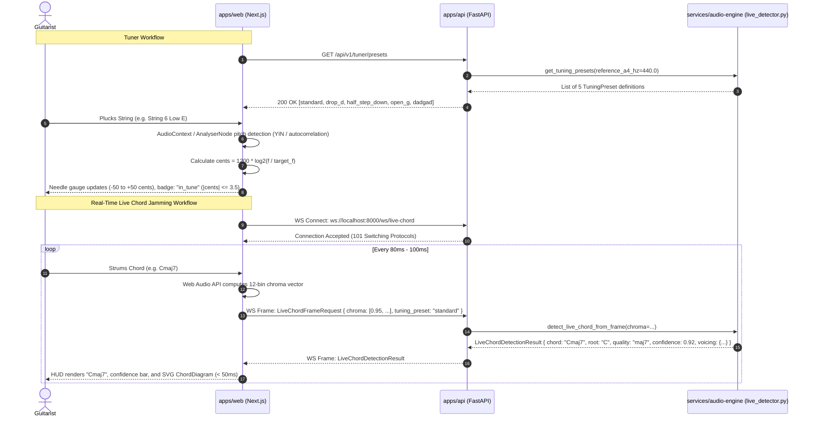

# Arpegia Monorepo Architecture & Package Boundaries (Phase 1, Phase 2, Phase 3, Phase 4 & Phase 5)

## 1. System Overview

Arpegia is an AI-powered Guitar Intelligence Platform engineered to ingest audio files (MP3/WAV), extract musical key, tempo, and chord progressions, synthesize biomechanically realistic guitar tablature (`TablatureData`), generate 6-string chord voicing diagrams (`ChordDiagram`), enable interactive fretboard & tab editing, synthesize polyphonic style & fingerstyle arrangements (`ArrangementVariation`), perform genre-aware re-harmonization, export playable scores to MIDI, MusicXML/GuitarPro, ASCII Tab, and PDF, stream real-time pipeline execution progress via WebSockets and HTTP polling, and provide a **Live Microphone Guitar Tuner** and **Real-Time Mic Chord Detector** with a distraction-free stage UX.

The repository is organized as a multi-package monorepo designed for clean boundary separation and conflict-free parallel development across multiple specialized agents.

---

## 2. Monorepo Directory Boundaries & Ownership

```
arpegia/
├── apps/
│   ├── web/                  # Next.js App Router (TypeScript, Tailwind, React 19) — Port 3000
│   └── api/                  # Python FastAPI REST & WebSocket Gateway — Port 8000
├── services/
│   └── audio-engine/         # Python DSP (Librosa, FFmpeg), Tab & Arrangement Synthesizer, Exporters, Live Detector & LangGraph AI
├── packages/
│   └── shared-types/         # Cross-package TypeScript (index.ts) & Pydantic v2 (schemas.py) contracts
├── infrastructure/
│   └── docker/               # Dedicated Dockerfiles for each service
├── docs/
│   ├── architecture.md       # System architecture & agent boundary specifications
│   └── api-contract.md       # Canonical Phase 1 to Phase 5 REST, WebSocket & schema contracts
├── AGENT_RULES.md            # Strict Gate 2 directory jail & read-only enforcement rules
├── docker-compose.yml        # Local development orchestration
├── .env.example              # Canonical environment variable specifications
├── .gitignore                # Unified monorepo ignore rules
└── README.md                 # Primary project entry point
```

### Canonical Port Registry

| Service | Directory | Port | Base URL / Protocols |
| :--- | :--- | :--- | :--- |
| **Web Frontend (Next.js)** | `apps/web/` | `3000` | `http://localhost:3000` |
| **Backend API Gateway (FastAPI)** | `apps/api/` | `8000` | `http://localhost:8000`<br>`ws://localhost:8000/ws/analyze/{job_id}`<br>`ws://localhost:8000/ws/live-chord` |
| **Audio Engine (DSP & LangGraph)** | `services/audio-engine/` | In-process / Worker | Invoked by `apps/api` or CLI |

### Boundary Guidelines for Parallel Agents (Gate 2)

| Path | Primary Language | Boundary Scope & Responsibilities | Allowed Cross-Imports |
| :--- | :--- | :--- | :--- |
| **`apps/web`** | TypeScript / React | User interface, audio timeline, `ChordDiagram` visualizer, `TablatureData` viewer, Interactive Tab Editor, Phase 3 Style Arrangement Generator, Multi-Format Export, Phase 4 Real-Time Pipeline Streaming UI, and Phase 5 Live Microphone Guitar Tuner (pitch needle gauge, string selector, presets) and Real-Time Mic Chord Detector HUD (distraction-free live jamming stage view). | Consumes `@arpegia/shared-types`. Must **never** modify `packages/` or backend Python files during Gate 2. |
| **`apps/api`** | Python (FastAPI) | HTTP & WebSocket routing (`POST /api/v1/analyze`, `GET /api/v1/analyze/{job_id}`, `GET /api/v1/analyze/{job_id}/progress`, `WS /ws/analyze/{job_id}`, `PUT /api/v1/analyze/{job_id}/tablature`, `POST /api/v1/analyze/{job_id}/arrange`, `GET /api/v1/analyze/{job_id}/export`, `GET /api/v1/tuner/presets`, `POST /api/v1/live/detect-chord`, `WS /ws/live-chord`), background task lifecycle, and `services/audio-engine` orchestration. | References `packages/shared-types/schemas.py` and invokes `services/audio-engine`. |
| **`services/audio-engine`** | Python | Core audio signal processing (Librosa), key/BPM/chord detection, polyphonic/monophonic note transcription, biomechanical guitar fret-string optimization (`TabNote`, `TabMeasure`, `ascii_tab`), chord diagram resolution (`ChordDiagram`), Phase 3 polyphonic voice separation (`VoiceRole`), style arrangement generator (`ArrangementVariation`), multi-format exporters, LangGraph pipeline orchestrator, and Phase 5 live pitch & chord detection module (`services/audio-engine/engine/live_detector.py`). | Operates as a modular processing engine invoked by `apps/api` or standalone CLI. |
| **`packages/shared-types`** | TypeScript & Python | **READ-ONLY in Gate 2.** Source of truth for TypeScript interfaces (`index.ts`) and Python Pydantic v2 schemas (`schemas.py`). | Imported/mirrored by `apps/web`, `apps/api`, and `services/audio-engine`. |
| **`infrastructure/`** | Docker / Compose | Containerization scripts and system setup. | References app files from build contexts. |

---

## 3. Phase 4 Communication & Streaming Flows

```
[apps/web (Next.js :3000)]
       │
       │── (1) POST /api/v1/analyze?async_mode=true (MP3/WAV) ──► [apps/api (FastAPI :8000)]
       │◄─ (2) 202 Accepted { job_id, event: "job.progress" } ───┤ (Spawns background task)
       │                                                         │
       │── (3) WS connect: /ws/analyze/{job_id} ────────────────►│ (FastAPI WebSocket Route)
       │   (or fallback: GET /api/v1/analyze/{job_id}/progress)  │
       │                                                         ▼ (4) run_pipeline(..., progress_callback)
       │                                                 [services/audio-engine]
       │                                                  ├─ (0%-25%)   separating_stems
       │                                                  ├─ (25%-40%)  detecting_key_tempo
       │                                                  ├─ (40%-60%)  detecting_chords
       │                                                  ├─ (60%-85%)  transcribing_tablature
       │                                                  └─ (85%-100%) generating_arrangement
       │                                                         │
       │◄─ (5) WS Frame: JobProgressEvent ("job.progress") ◄─────┤ (Progress callback updates)
       │◄─ (6) WS Final: JobProgressEvent ("job.completed") ◄────┘ (Contains full AnalysisResponse result)
       │       (WebSocket cleanly closed by server)
       │
       ├── (7) PUT /api/v1/analyze/{job_id}/tablature ──────────► [apps/api (FastAPI :8000)]
       │       (Interactive Tab Editor updates note/measure)
       │
       ├── (8) POST /api/v1/analyze/{job_id}/arrange ───────────► [apps/api (FastAPI :8000)]
       │       (Generates custom style arrangement variation)
       │
       └── (9) GET /api/v1/analyze/{job_id}/export ─────────────► [apps/api (FastAPI :8000)]
               (?format=midi|musicxml|ascii|pdf&arrangement_id=...)
```

### The 5 Ordered Pipeline Stages & Percentage Milestones

| Stage Index | Stage Identifier (`PipelineStage`) | Milestone Range | Processing Description |
| :---: | :--- | :---: | :--- |
| **1** | `separating_stems` | **0% -> 25%** | Demucs 4-stem source separation (isolates guitar, bass, drums, vocals) or deterministic fast-skip if disabled. |
| **2** | `detecting_key_tempo` | **25% -> 40%** | Audio loading, onset detection, tempo / BPM tracking, and Krumhansl-Schmuckler key profile correlation. |
| **3** | `detecting_chords` | **40% -> 60%** | Constant-Q / chromagram harmonic analysis, chord label estimation, voicing resolution, and genre-specific re-harmonization suggestions. |
| **4** | `transcribing_tablature` | **60% -> 85%** | Basic Pitch polyphonic note extraction, note segmentation, and biomechanical fretboard optimization via Viterbi shortest-path decoding (`TabNote`, `TabMeasure`, `ascii_tab`). |
| **5** | `generating_arrangement` | **85% -> 100%** | Polyphonic voice separation (`VoiceRole`: melody, bass, harmony, percussive), style arrangement generation (`ArrangementVariation`), and final score validation. |

---

## 4. Phase 5 Real-Time Live Microphone & Tuner Architecture

Phase 5 introduces real-time microphone interactions for live guitarists:
1. **Precision Guitar Tuner:** Visual needle gauge measuring cents deviation against 5 canonical tuning presets with `abs(cents) <= 3.5` in-tune threshold.
2. **Real-Time Microphone Chord Detector:** Low-latency (< 50ms) chord recognition streaming over WebSocket (`WS /ws/live-chord`) or REST fallback (`POST /api/v1/live/detect-chord`) with SVG chord diagrams.
3. **Distraction-Free UX:** Stage HUD with large high-contrast chord symbols, confidence indicator, detected pitch classes, and minimal visual noise.

### Real-Time Interaction Sequence Diagram



### Tuner Pitch Evaluation Mechanics

The tuner calculates pitch deviation using the logarithmic cents formula:

$$\Delta\text{cents} = 1200 \times \log_2\left(\frac{f_{\text{detected}}}{f_{\text{target}}}\right)$$

- **Tuning Status Thresholds:**
  * `in_tune`: $|\Delta\text{cents}| \le 3.5$ cents
  * `flat`: $\Delta\text{cents} < -3.5$ cents
  * `sharp`: $\Delta\text{cents} > +3.5$ cents
- **Supported Presets:**
  * **Standard (E A D G B E):** E2 (82.41 Hz), A2 (110.00 Hz), D3 (146.83 Hz), G3 (196.00 Hz), B3 (246.94 Hz), E4 (329.63 Hz)
  * **Drop D (D A D G B E):** D2 (73.42 Hz), A2 (110.00 Hz), D3 (146.83 Hz), G3 (196.00 Hz), B3 (246.94 Hz), E4 (329.63 Hz)
  * **Half Step Down (Eb Ab Db Gb Bb Eb):** Eb2 (77.78 Hz), Ab2 (103.83 Hz), Db3 (138.59 Hz), Gb3 (185.00 Hz), Bb3 (233.08 Hz), Eb4 (311.13 Hz)
  * **Open G (D G D G B D):** D2 (73.42 Hz), G2 (98.00 Hz), D3 (146.83 Hz), G3 (196.00 Hz), B3 (246.94 Hz), D4 (293.66 Hz)
  * **DADGAD (D A D G A D):** D2 (73.42 Hz), A2 (110.00 Hz), D3 (146.83 Hz), G3 (196.00 Hz), A3 (220.00 Hz), D4 (293.66 Hz)

### Distraction-Free UX Principles for Stage & Practice

1. **High Contrast & Large Typography:** Essential information (chord name, tuning needle, in-tune badge) is visible from a music stand distance (> 1 meter).
2. **Minimal Visual Noise:** Clean dark background with optional full-screen toggle, suppressing unnecessary menus, sliders, or distracting animations.
3. **Reactive Color Psychology:**
   - Green (`#10B981` / `emerald-500`): Perfect pitch (`|cents| <= 3.5`) or high chord confidence (`>= 0.85`).
   - Amber (`#F59E0B` / `amber-500`): Slight deviation or moderate confidence (`0.60 <= conf < 0.85`).
   - Slate / Rose (`#64748B` / `#EF4444`): Off-pitch or unrecognized frame.
4. **Resilient Reconnection:** WebSocket client automatically reconnects with exponential backoff and gracefully falls back to `POST /api/v1/live/detect-chord`.

---

## 5. Multi-Agent Development Principles (Gate 1 & Gate 2)

To prevent merge conflicts and maintain system integrity when multiple agents work concurrently (see [`AGENT_RULES.md`](../AGENT_RULES.md)):

1. **Strict Directory Jails (Gate 2):**
   - **Web Agent** is strictly confined to `apps/web/`.
   - **API Agent** is strictly confined to `apps/api/`.
   - **Audio Engine Agent** is strictly confined to `services/audio-engine/`.
2. **Read-Only Shared Contracts in Gate 2:**
   - `packages/`, `docs/api-contract.md`, `docs/architecture.md`, `AGENT_RULES.md`, and `.env.example` are **READ-ONLY** during Gate 2 execution.
3. **No Root Package Contamination:**
   - Never run `npm install` at the repository root or create `package.json`, `package-lock.json`, `node_modules/`, or `requirements.txt` in the root directory.
